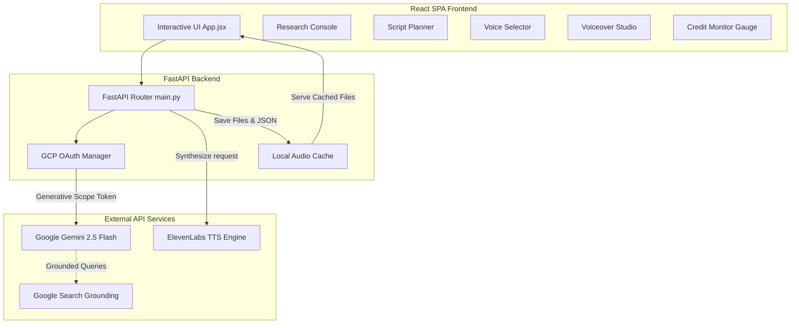

# Script Planner & Voiceover Studio

An interactive, AI-driven web application designed to streamline video content creation. The platform enables creators to perform real-time grounded research on technical topics using Google Gemini with Search Grounding, generate structured, multiline video outlines/scripts, audition professional narrators, fine-tune voice characteristics, and synthesize audio segments using ElevenLabs Text-to-Speech (TTS).

---

## 🏗️ Architecture Overview

The system features a decoupled client-server architecture:
*   **Frontend**: A responsive React single-page application built with Vite and Tailwind CSS (v4), featuring custom glassmorphism overlays and dynamic layout panels.
*   **Backend**: A high-performance FastAPI web server in Python that coordinates API requests, handles OAuth token updates for Google Cloud, and interfaces with the ElevenLabs endpoint.
*   **Cache Store**: A local directory (`backend/audio_cache`) that serves as a file-based storage repository for audio files (`.mp3`) and metadata logs (`.json`), optimizing budget/quota consumption.



---

## 🌟 Key Features

1.  **AI Grounded Research Console**
    *   Executes real-time, fact-checked searches using `gemini-2.5-flash` with Google Search Grounding.
    *   Generates rich markdown summaries, displays search query grounding logs, and lists verified hyperlinks to source web pages.
    *   Allows immediate transitions to the script planner using the researched summary as a factual context payload.

2.  **Interactive Script & Storyboard Planner**
    *   Synthesizes line-by-line scripts (with Hook, Body, and Call-to-Action segments) based on format (Shorts/Reels vs Long Video), target duration, audience, tone settings (e.g. Professional, Energetic, Casual, Explainer, Dramatic), and custom directives.
    *   Provides an editable storyboard editor to adjust visual cues, segment sections, and narrative texts.
    *   Maintains real-time metrics trackers for word count, character count, and estimated duration forecast (estimating voice pace at ~140 words per minute).

3.  **Audition & Select ElevenLabs Voice**
    *   Pulls up-to-date voice assets directly from the ElevenLabs catalog.
    *   Filters voices dynamically by gender, accent, age, and use cases.
    *   Enables instant, inline playback of voice actor auditions.

4.  **Voiceover Production Studio**
    *   Generates high-quality TTS audio for individual storyboard segments or batch-processes remaining segments.
    *   Exposes advanced parameter configurations (Model selection, Stability, Clarity/Similarity Boost, Style Exaggeration, Speech Speed Multipliers, and Speaker Boost).
    *   Features an audio player, download links, and cache cleanup tools.

5.  **Credit Monitor & Forecast circular gauge**
    *   Reads remaining ElevenLabs subscription counts dynamically.
    *   Highlights the character cost of the active script layout.
    *   Warns users when character requirements exceed their current ElevenLabs balance.

6.  **YouTube Video Import**
    *   Inspects a video from your own channel or another authorized source and lists available resolutions.
    *   Downloads video at the best available quality or a selected maximum resolution, or extracts audio as high-quality MP3.
    *   Optionally downloads a clip by start and end timestamps instead of the full video.
    *   Requires confirmation that you own or have permission to download the video.

---

## 🛠️ Technology Stack

### Backend
*   **FastAPI** (`0.110.0`): Web API development framework.
*   **Uvicorn** (`0.28.0`): ASGI web server.
*   **Google Auth** (`2.28.2`): GCP Service Account credentials manager.
*   **Requests** (`2.31.0`): HTTP requests client.
*   **Python Dotenv** (`1.0.1`): Environment variable loader.
*   **yt-dlp**: YouTube video information and download support.

### Frontend
*   **React** (`^19.0.0`): Declarative UI library.
*   **Vite** (`^6.1.0`): Fast frontend tooling and development server.
*   **Tailwind CSS** (`^4.0.0`): Utility-first styling with native CSS nesting imports.
*   **Lucide React** (`^0.475.0`): Visual icons.

---

## 📂 Project Structure

```
storyboard/
├── backend/
│   ├── main.py                    # Core FastAPI server application
│   ├── requirements.txt           # Python backend dependencies
│   ├── .env                       # Environment credentials configuration (ignored)
│   ├── service-account.json       # GCP credentials key (ignored)
│   └── audio_cache/               # Local cache for MP3s and metadata JSONs
│       ├── voiceover_[UUID].mp3
│       └── voiceover_[UUID].json
├── frontend/
│   ├── index.html                 # Main entry HTML template
│   ├── package.json               # Node dependencies and scripts
│   ├── vite.config.js             # Vite configurations and server proxy
│   └── src/
│       ├── main.jsx               # React client initialization
│       ├── App.jsx                # Main application state and layout manager
│       ├── index.css              # Tailwind and custom premium styles/animations
│       └── components/
│           ├── CreditStatus.jsx   # ElevenLabs character budget indicators
│           ├── ResearchUpdates.jsx# Google Search Grounding dashboard
│           ├── ScriptPlanner.jsx  # Storyboard structure editor
│           ├── VoiceSelector.jsx  # Catalog browser for voice auditions
│           └── VoiceOverCreator.js# TTS engine workspace and history panel
└── README.md                      # Documentation
```

---

## 🚀 Getting Started & Setup

### Prerequisites
*   **Python 3.10+**
*   **Node.js 18+**
*   **FFmpeg** available on `PATH` (required to combine streams and trim timestamped clips).
*   **Google Cloud Platform** service account with access enabled for the `Generative Language API` (`https://www.googleapis.com/auth/generative-language` scope).
*   **ElevenLabs** account and active API Key.

---

### 1. Backend Setup

1.  Navigate to the `backend` directory:
    ```bash
    cd backend
    ```

2.  Create and activate a virtual environment:
    ```bash
    # Windows
    python -m venv venv
    venv\Scripts\activate

    # macOS/Linux
    python3 -m venv venv
    source venv/bin/activate
    ```

3.  Install dependencies:
    ```bash
    pip install -r requirements.txt
    ```

4.  Configure Environment Credentials:
    Create a `.env` file in the `backend/` folder:
    ```env
    ELEVENLABS_API_KEY=your_elevenlabs_api_key_here
    GOOGLE_APPLICATION_CREDENTIALS=service-account.json
    ```
    *Note: Ensure your GCP service account JSON key is saved as `service-account.json` in the `backend/` directory.*

5.  Launch the FastAPI server:
    ```bash
    uvicorn app.main:app --reload --port 8001
    ```
    The API documentation will be available at `http://localhost:8001/docs`.

    *Note: port `8001` is deliberate — the Vite dev proxy (`frontend/vite.config.js`) forwards
    `/api`, `/audio`, and `/visuals` here. If you change it, change both places.*

    *Note: install FFmpeg separately and ensure `ffmpeg` is available on `PATH` before using YouTube Import.*

---

### 2. Frontend Setup   

1.  Navigate to the `frontend` directory:
    ```bash
    cd ../frontend
    ```

2.  Install packages:
    ```bash
    npm install
    ```

3.  Start the Vite development server:
    ```bash
    npm run dev
    ```
    Open the URL Vite prints (`http://localhost:5173`, or the next free port if 5173 is taken). The Vite server is pre-configured to proxy `/api`, `/audio`, and `/visuals` routes to the backend on `localhost:8001`.

---

## 🔌 API Endpoints Reference

The backend exposes the following API routes under the `/api` prefix:

### 🎫 System & Credits
*   **`GET /api/health`**
    *   Verifies that the FastAPI server is running.
*   **`GET /api/credits`**
    *   Fetches character balances and user subscription status from ElevenLabs.

### 🔍 Grounded AI Research
*   **`POST /api/research`**
    *   **Payload**: `{ "query": "search query" }`
    *   **Action**: Prompts Gemini 2.5 Flash using real-time search grounding tools to deliver a factual summary, query keywords, and cited website links.

### ▶️ YouTube Video Import
*   **`POST /api/youtube/info`**
    *   **Payload**: `{ "url": "https://www.youtube.com/watch?v=...", "has_permission": true }`
    *   **Action**: Returns the video title, duration, thumbnail, and available resolutions. The permission confirmation is required.
*   **`POST /api/youtube/download`**
    *   **Payload**: `{ "url": "https://www.youtube.com/watch?v=...", "has_permission": true, "media_type": "audio", "quality": "best", "start_seconds": 30, "end_seconds": 90 }`
    *   **Action**: Returns a video or high-quality MP3 audio download, optionally trimmed to the requested timestamps. `media_type` may be `video` or `audio`. Video `quality` may be `best`, `2160`, `1440`, `1080`, `720`, `480`, or `360`; omit both timestamp fields to download the full media.

### 📝 Storyboard Scripting
*   **`POST /api/generate-script`**
    *   **Payload**:
        ```json
        {
          "topic": "topic details",
          "video_type": "short" | "long",
          "duration": 60,
          "tone": "Professional" | "Energetic" | "Explainer" | "Dramatic" | "Casual",
          "audience": "Target audience",
          "instructions": "custom requests",
          "research_context": "grounded summary context"
        }
        ```
    *   **Action**: Synthesizes a structured storyboard outline containing visual descriptions and narrative texts returned as a clean JSON schema.

### 🎙️ Voiceover Synthesis & Caching
*   **`GET /api/voices`**
    *   Returns the list of available ElevenLabs voices with accents, gender tags, and preview files.
*   **`POST /api/voiceover`**
    *   **Payload**:
        ```json
        {
          "text": "Script dialogue text",
          "voice_id": "elevenlabs_voice_uuid",
          "voice_name": "voice name",
          "stability": 0.5,
          "similarity_boost": 0.75,
          "model_id": "eleven_monolingual_v1",
          "style": 0.0,
          "use_speaker_boost": true,
          "speed": 1.0
        }
        ```
    *   **Action**: Renders dialogue text using ElevenLabs TTS, saves the output `.mp3` and its `.json` metadata card to the `audio_cache` directory, and returns the track statistics.
*   **`GET /api/history`**
    *   Reads and returns all synthesized audio tracks in descending chronological order from the cache metadata.
*   **`DELETE /api/history/{filename}`**
    *   Removes a specified `.mp3` track and its companion metadata `.json` file from the local cache.
